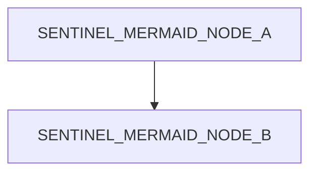

# SENTINEL_H1_TITLE

## SENTINEL_H2_HEADING

Here is a paragraph with **SENTINEL_BOLD_TEXT** and a standard markdown baseline.

| Col A | Col B |
| --- | --- |
| SENTINEL_TABLE_CELL_1 | SENTINEL_TABLE_CELL_2 |

<CardGroup>
  <Card title="SENTINEL_CARD_TITLE">SENTINEL_CARD_BODY</Card>
</CardGroup>

<Steps>
  <Step title="SENTINEL_STEP_TITLE">SENTINEL_STEP_BODY</Step>
</Steps>

<Callout type="info">SENTINEL_CALLOUT_BODY</Callout>

<AccordionGroup>
  <Accordion title="SENTINEL_ACCORDION_TITLE">SENTINEL_ACCORDION_BODY</Accordion>
</AccordionGroup>

<Expandable title="SENTINEL_EXPANDABLE_TITLE">SENTINEL_EXPANDABLE_BODY</Expandable>

<CodeGroup>
  <CodeGroupItem title="SENTINEL_CODE_TAB">console.log("SENTINEL_CODE_CONTENT");</CodeGroupItem>
</CodeGroup>

Dynamic brace test: {SENTINEL_DYNAMIC_VAR}

SENTINEL_SUMMARY_BODY

<Jargon term="SENTINEL_JARGON_TERM">SENTINEL_JARGON_BODY</Jargon>

<InterleafAnswer>SENTINEL_INTERLEAF_BODY</InterleafAnswer>

<YouTube id="SENTINEL_YT_VIDEO_123" />

<WhiteboardImage src="SENTINEL_WHITEBOARD_IMG.png" alt="SENTINEL_WHITEBOARD_ALT" />

<MicroQuiz question="SENTINEL_QUIZ_QUESTION">SENTINEL_QUIZ_BODY</MicroQuiz>

<BogusCustomWidget>SENTINEL_UNKNOWN_WIDGET_BODY</BogusCustomWidget>
